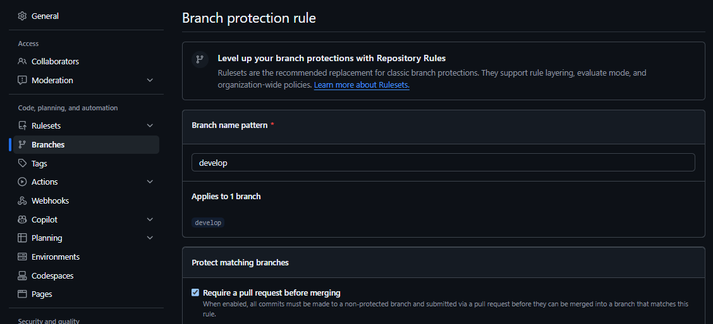
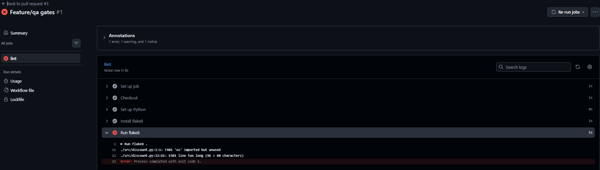
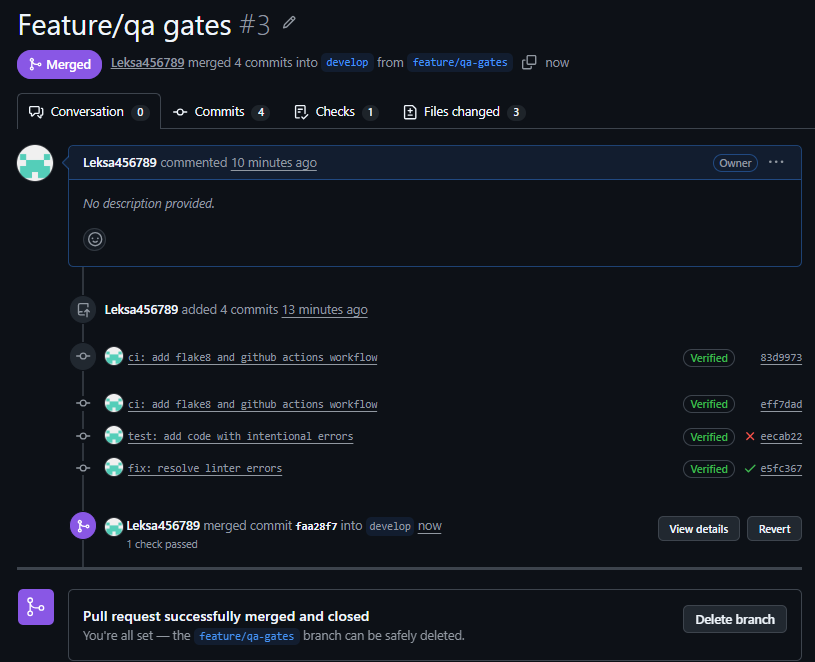
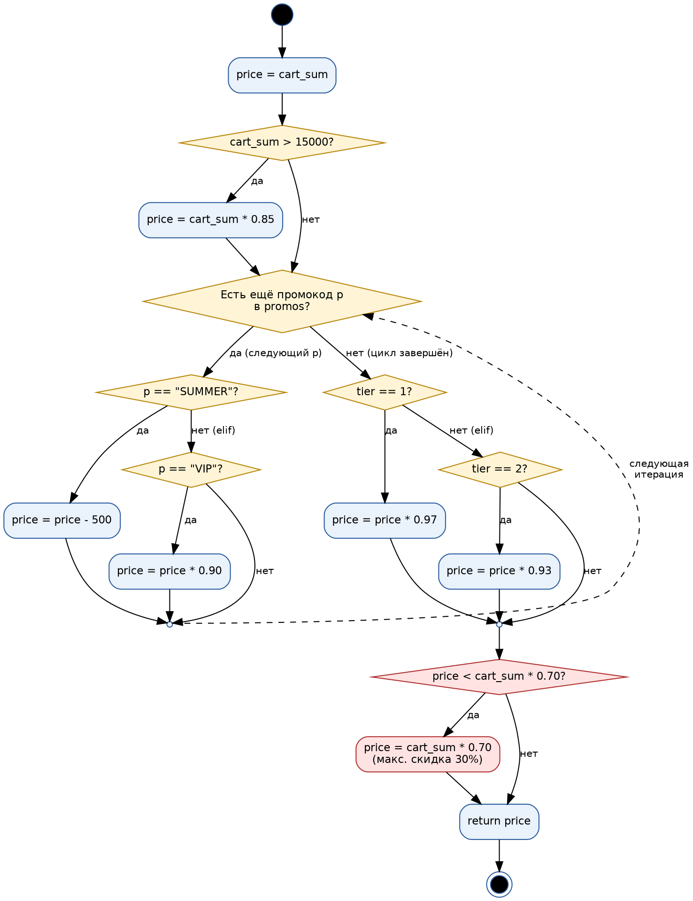

# Итоговый аналитический отчет (Лабораторная работа №1)

## 1. Резюме (Executive Summary)
Для микросервиса «Расчет корзины и скидок» системы лояльности выбрана СУБД, настроен репозиторий с моделью ветвления и защитой базовой ветки, внедрён quality gate на основе flake8 и GitHub Actions, проведён анализ legacy-алгоритма расчёта (UML + code smells) и подготовлен план code-review. **Главные результаты:** выбрана PostgreSQL (4.45 против 3.55 у MongoDB), `develop` защищена правилом Pull Request, CI блокирует код с ошибками линтера, алгоритм расчёта задокументирован и отрефакторен.

## 2. Сравнительный анализ технологий

### 2.1. Матрица принятия решений
| Критерий | Вес | PostgreSQL (балл) | MongoDB (балл) |
|---|---|---|---|
| Поддержка ACID-транзакций | 0.35 | 5 | 3 |
| Целостность данных (FK, ограничения) | 0.20 | 5 | 2 |
| Производительность чтения | 0.20 | 4 | 5 |
| Гибкость схемы | 0.10 | 3 | 5 |
| Стоимость владения и экосистема | 0.15 | 4 | 4 |
| **Сумма весов** | **1.00** | | |

### 2.2. Расчет и обоснование выбора
Формула: `Оценка = Σ (Вес_критерия × Балл_кандидата)`

- **PostgreSQL** = 0.35·5 + 0.20·5 + 0.20·4 + 0.10·3 + 0.15·4 = 1.75 + 1.00 + 0.80 + 0.30 + 0.60 = **4.45**
- **MongoDB** = 0.35·3 + 0.20·2 + 0.20·5 + 0.10·5 + 0.15·4 = 1.05 + 0.40 + 1.00 + 0.50 + 0.60 = **3.55**

**Вывод:** побеждает PostgreSQL. Для хранения транзакций и баллов критичны ACID и строгая целостность (поэтому их суммарный вес 0.55). MongoDB выигрывает в гибкости схемы и скорости чтения, но эти критерии менее важны для финансовых данных; недостаток гибкости PostgreSQL частично компенсируется типом JSONB.

## 3. Архитектура и контроль версий

### 3.1. Настройка репозитория
Модель ветвления (упрощённый Git Flow): `main` (стабильная) ← `develop` (интеграционная) ← `feature/*` (`feature/infrastructure`, `feature/qa-gates`, `feature/review-plan`). Все изменения попадают в `develop` только через Pull Request.

Репозиторий: <https://github.com/Leksa456789/lab1-comprehensive-kolesnichenko>

### 3.2. Контроль доступа
Скриншот Branch Protection (правило для `develop`, Require a pull request before merging):



Содержимое `.github/CODEOWNERS`:
```
* @Leksa456789
```

## 4. Инструментальный контроль качества

### 4.1. Настройка CI/CD
Файл: [.github/workflows/qa.yml](.github/workflows/qa.yml). Pipeline запускает flake8 при каждом Pull Request в `develop`. Правила линтера — в [.flake8](.flake8) (максимальная длина строки 80).

### 4.2. Работа Quality Gate
Скриншоты PR: красный статус → зелёный статус.




Ошибки линтера в коммите `test: add code with intentional errors`:
```
src/discount.py:1:1: F401 'os' imported but unused
src/discount.py:22:81: E501 line too long (96 > 80 characters)
```
Исправление (коммит `fix: resolve linter errors`): удалён неиспользуемый `import os`, длинная строка комментария удалена, магические числа вынесены в константы. После этого проверка стала зелёной, PR слит в `develop`.

Pull Request: <https://github.com/Leksa456789/lab1-comprehensive-kolesnichenko/pull/3>

## 5. Обратное проектирование и планирование ревью

### 5.1. Анализ алгоритма


[UML Diagram](docs/uml_diagram.png)

**Code smells в legacy-фрагменте:**
1. **Магические числа** (15000, 0.85, 500, 0.90, 0.97, 0.93, 0.70) — смысл неочевиден, менять трудно.
2. **Магические строки** промокодов (`"SUMMER"`, `"VIP"`) разбросаны по коду.
3. **Отсутствие валидации** входных данных (отрицательная сумма, `None`, неверный `tier`, `promos` не список).
4. **Использование `float` для денег** — ошибки округления; нужен `Decimal`/копейки.
5. **Нечитаемые имена** (`p`, `tier == 1/2` без объяснения).
6. **Жёсткая зависимость от порядка применения скидок** — не зафиксирована и не документирована.
7. **Фиксированный вычет 500 для `SUMMER`** может уйти в минус до применения нижней границы; повторный `SUMMER` в списке применяется многократно (риск фрода).
8. **`if/elif` для уровней лояльности и промокодов** — плохо масштабируется; лучше словарь/стратегии.
9. **Дублирование выражения** `cart_sum * 0.70` и отсутствие документации/тестов.
10. **Совмещение нескольких ответственностей** в одной функции (скидки, промокоды, лояльность, ограничение).

### 5.2. План code-review
Подход: ревью по чек-листу (точность расчётов, защита от фрода, корректность скидок) с участием разработчика, QA и представителя безопасности; CI должен быть зелёным до начала ревью. Полный план: [docs/review-plan.md](docs/review-plan.md).

Открытый Pull Request с планом ревью: <https://github.com/Leksa456789/lab1-comprehensive-kolesnichenko/pull/5>

**Ключевые критерии:** 0 магических чисел, валидация входных данных, покрытие тестами > 80%, 0 замечаний flake8.

**Эскалация:** обсуждение в PR (до 2 итераций) → созвон с модератором (15 мин) → решение Tech Lead/владельца продукта с фиксацией в PR.

## 6. Заключение
Настроенные процессы снижают риск дефектов на нескольких уровнях: защита `develop` и CODEOWNERS исключают прямые незаревьюенные изменения; flake8 в CI автоматически блокирует ошибки стиля и неиспользуемый код до слияния; UML и анализ code smells делают скрытую логику расчёта прозрачной; формализованный план ревью с измеримыми критериями и эскалацией делает проверку воспроизводимой. Обоснованный выбор PostgreSQL (ACID, целостность) снижает риски потери и рассогласования финансовых данных.
